# CLAWD: EL LOOP

Un juego de plataformas 3D donde juegas el loop de un agente de IA: observar, pensar, actuar,
verificar. Eres Clawd, y cada mecánica del juego enseña una pieza de cómo trabaja un agente.

> Demo de la comunidad. No es un producto oficial de Anthropic.

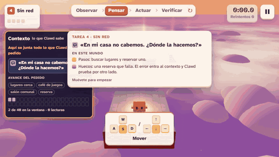

**Jugar:** [clawd-el-loop.pages.dev](https://clawd-el-loop.pages.dev/)

Funciona en el navegador, con teclado o con controles táctiles. Necesita conexión: Three.js se
carga desde cdnjs y las tipografías desde Google Fonts.

## Qué enseña

Diez tareas, en tres capítulos (Haiku, Sonnet y Opus), que explican el agente por dentro:

- **El loop.** Observa, piensa, actúa, verifica. Cada tarea es una vuelta completa.
- **Los papeles y el contexto.** Todo lo que pasa entra al panel de contexto como un papel de
  uno de cinco tipos: `system prompt`, `user message`, `tool call`, `tool result` y
  `assistant message`. Lo que se sale del contexto, el modelo ya no lo sabe.
- **El hook.** Pisar una respuesta inventada es un `tool call` que el hook rechaza. El
  rechazo entra al contexto como un papel más y la tarea sigue por otro camino.
- **Los subagentes.** En la última tarea el trabajo se reparte entre cuatro subagentes y cada
  uno devuelve un solo papel a tu contexto.
- **Una sola petición que crece.** Las diez tareas cuentan una historia: «Quiero organizar
  una noche de juegos para mis amigos el sábado». Cada tarea suma una parte del pedido y la
  última lo cierra con todo lo anterior.
- **Tu Clawd.** Eliges nombre, color y un accesorio hecho con cubos. El nombre entra al
  `system prompt` («Eres [nombre], …»): el rol de un agente lo escribe quien lo arma. Al final
  puedes descargar una tarjeta con tu Clawd y tus medallas.

Al terminar cada tarea, un recibo cuenta los papeles, los `tool calls` y las lecturas del
contexto. No hay cifras de dinero ni de tokens: el juego no las inventa.

| | |
|---|---|
| 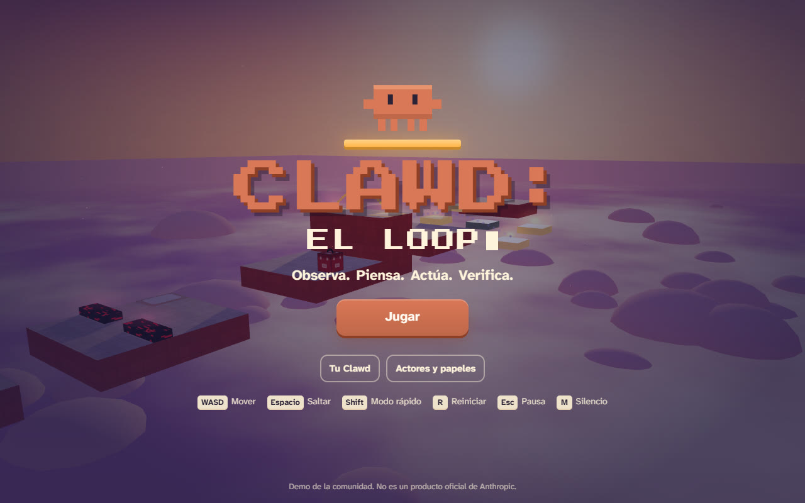 | 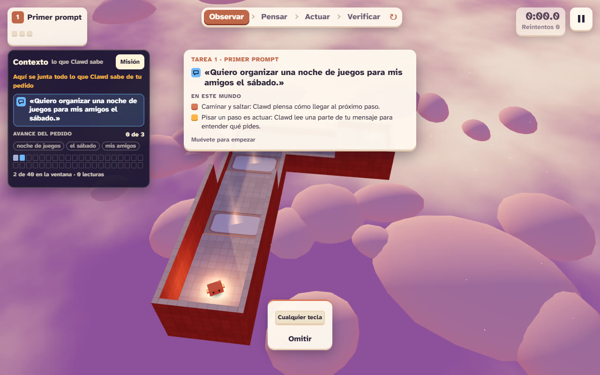 |
| 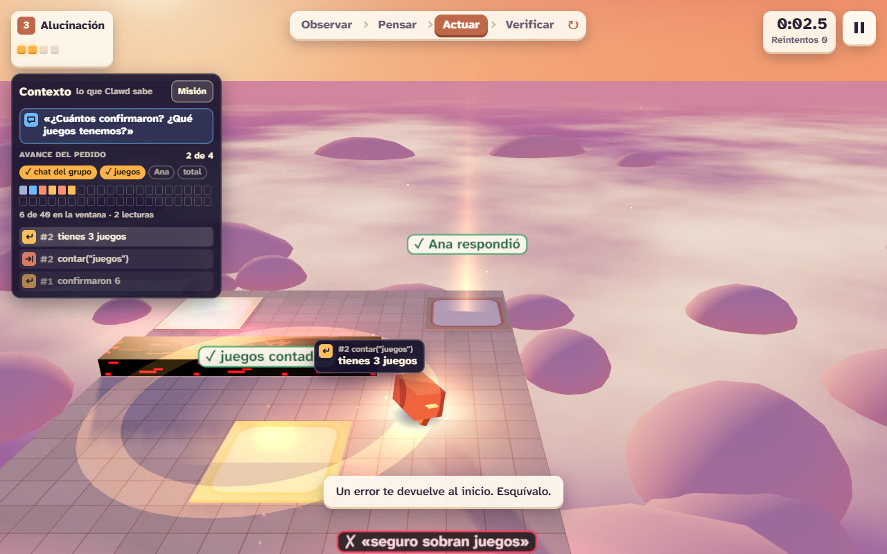 | 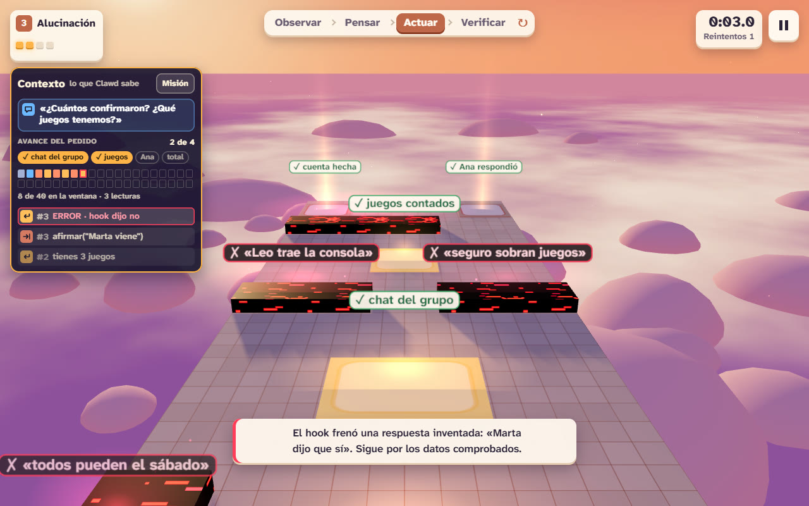 |
| 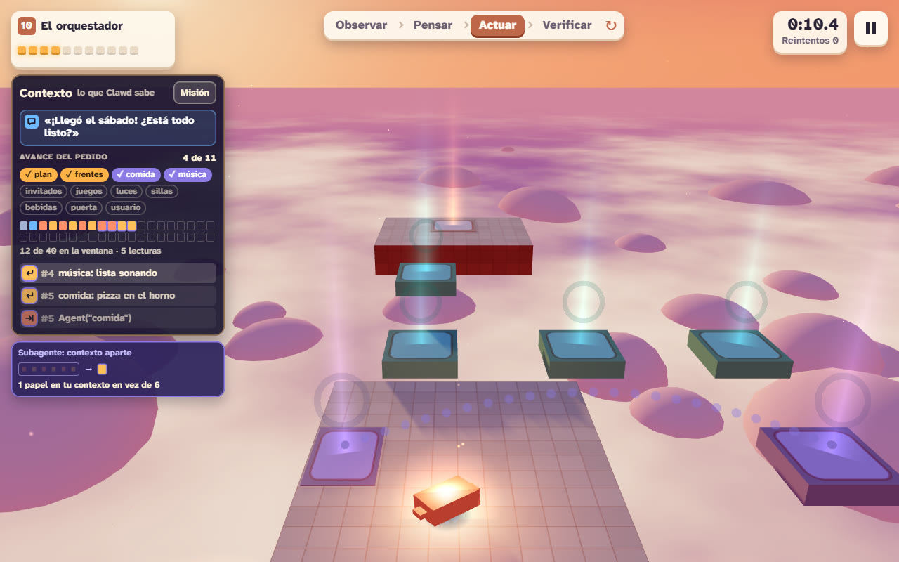 | 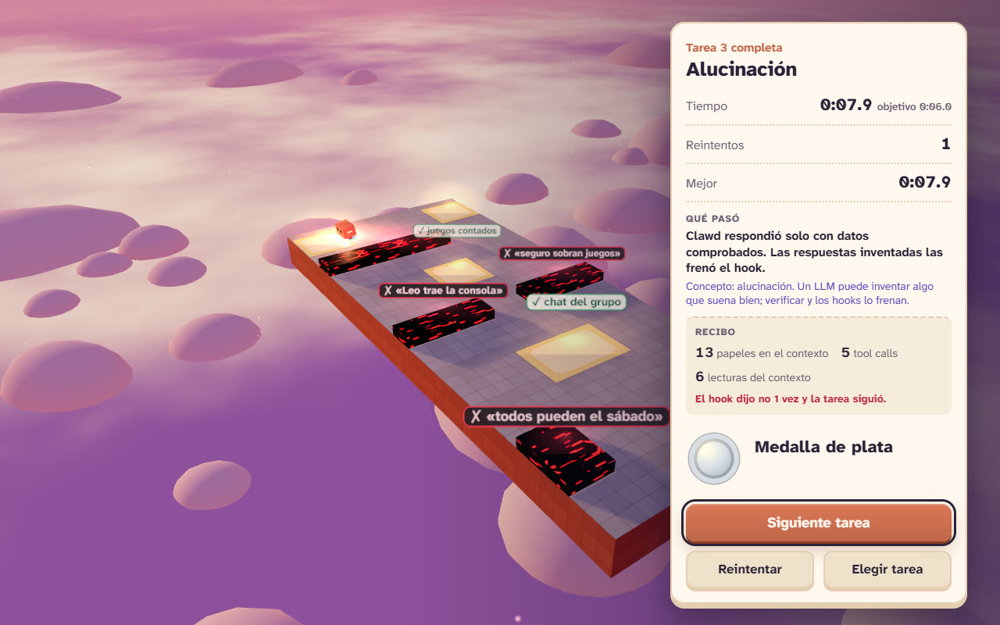 |
| 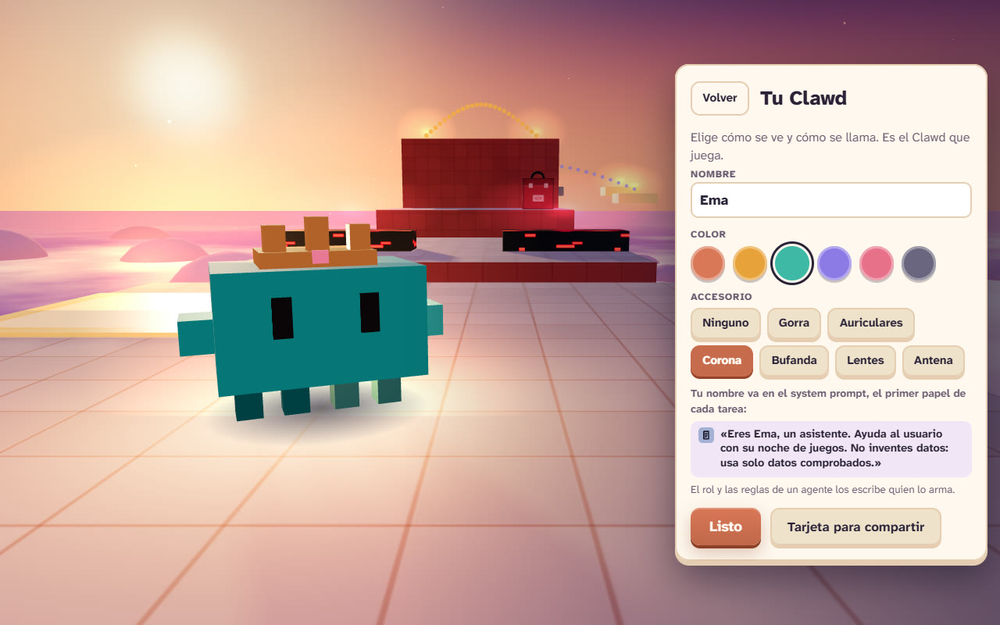 | 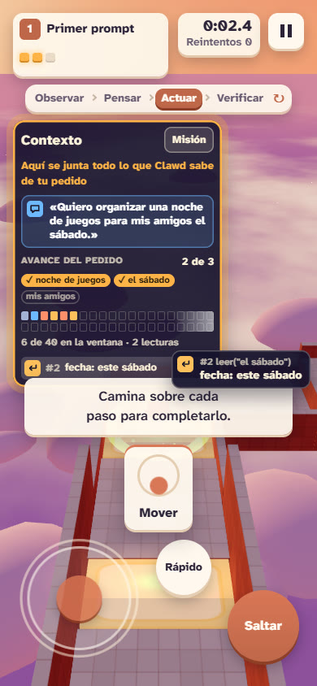 |
| 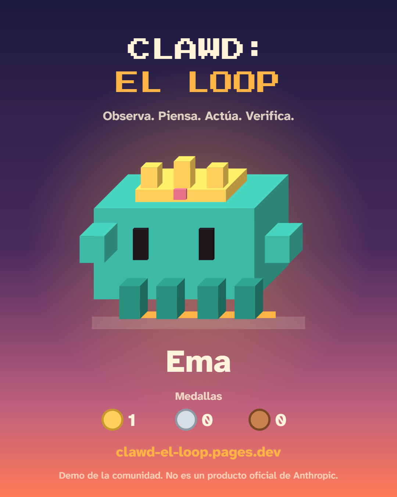 | 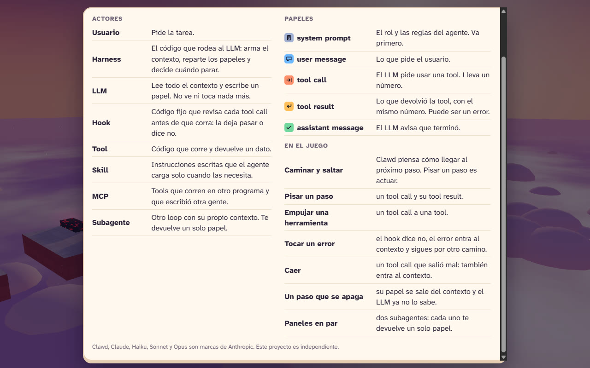 |

## De dónde salió

Nació en el **Claude for Gamers Workshop**, el 10 de noviembre de 2026 en las oficinas de
Platzi, en Bogotá: un evento presencial de la comunidad
[Claude Colombia](https://claudecolombia.com/), organizado por Camilo Rico y Jairo
Torregrosa. El taller se enfocó en crear videojuegos con inteligencia artificial, con
conceptos de animación y una sesión práctica con Claude Opus 5.5. El proyecto quedó en
**tercer lugar entre más de 50 proyectos**.

## Créditos

- La capa educativa (los actores, los cinco papeles y la forma de mostrar el contexto) se basa
  en el método "Actuar el loop" de Jairo Torregrosa, publicado en
  [`JairoTorregrosa/charlas`](https://github.com/JairoTorregrosa/charlas).
- Inspirado en las ideas de diseño de Bounce Friday, de Bruno Simon
  ([`brunosimon/three.js-journey-bounce-friday`](https://github.com/brunosimon/three.js-journey-bounce-friday)).
  El juego, sus niveles, textos, gráficos y sonidos están escritos desde cero.
- Render con [Three.js](https://threejs.org/) r160. Tipografías Press Start 2P y Atkinson
  Hyperlegible Next, desde Google Fonts.

## Cómo se construyó

Con Claude Code: una sesión orquestadora que planea y reparte el trabajo, y sesiones en
paralelo que ejecutan cada parte (núcleo y render, interfaz, audio, y después la capa
educativa, la narrativa, el panel de misión y "Tu Clawd"). El acuerdo entre las partes está en
[`docs/CONTRACT.md`](docs/CONTRACT.md).

Qué se verificó y qué no:

- `verify-chispa.mjs` es un bot que juega las 10 tareas sin navegador, con la ruta movida al
  azar: las completa en 20 de 20 corridas cada una y pasa 26 chequeos de mecánicas, papeles,
  narrativa y personalización.
- Se jugó en Chrome sin ventana, en escritorio y en celular emulado (vertical y horizontal),
  sin errores de consola. Esas pruebas de navegador no están en este repo.
- **No** se midió la fluidez (cuadros por segundo), **no** se probó en un celular real y
  nadie escuchó el audio con atención. Que una persona lo juegue y lo encuentre divertido
  tampoco lo prueba el bot: solo prueba que se puede completar.

## Cómo correrlo y verificarlo en local

Sin dependencias que instalar. Hace falta [Node.js](https://nodejs.org/) (probado con la
versión 24).

```bash
node build-chispa.mjs     # arma chispa.html y dist/ (index.html + og.png)
node verify-chispa.mjs    # el bot juega las 10 tareas; debe terminar con código 0
```

Para jugar, abre `dist/index.html` en un navegador.

Dónde está cada cosa:

| Archivo | Contiene |
|---|---|
| `chispa-core.js` | Física, las 10 tareas como datos, la historia y el transcript de papeles. Sin DOM |
| `chispa-shell.html` | Página fuente: render Three.js, cámara, bucle principal, teclado y metadatos |
| `chispa-ui.js`, `chispa-ui.css` | Pantallas, HUD, panel de contexto, recibo, glosario, "Tu Clawd" y táctil |
| `chispa-audio.js` | Todo el sonido, generado con Web Audio |
| `chispa.html` | **Generado** por `build-chispa.mjs`: el juego en un solo archivo. No se edita a mano |
| `dist/` | **Generado**: lo único que se publica (`index.html` y la imagen para vista previa) |
| `docs/` | El contrato entre las partes y las imágenes de este README |

Los archivos y la clave de guardado siguen llamándose `chispa`: es el nombre con el que
nació el proyecto y se conserva a propósito.

Para publicar una versión nueva en Cloudflare Pages:

```bash
node build-chispa.mjs && node verify-chispa.mjs
npx wrangler pages deploy dist --project-name clawd-el-loop --branch main
```

## Aviso y marcas

Demo de la comunidad. No es un producto oficial de Anthropic.

Clawd, Claude, Haiku, Sonnet y Opus son marcas de Anthropic. Este proyecto es independiente.

## Licencia

El código está bajo licencia [MIT](LICENSE). La licencia cubre el código de este repo; no
cubre el personaje Clawd ni las marcas mencionadas arriba.
